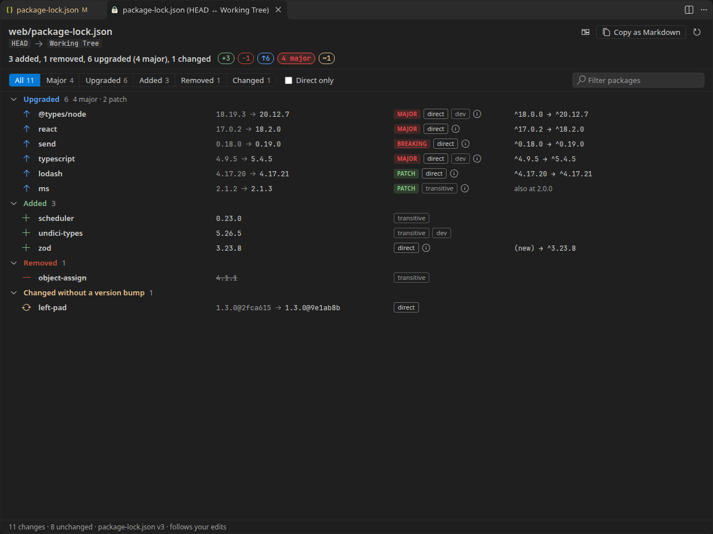
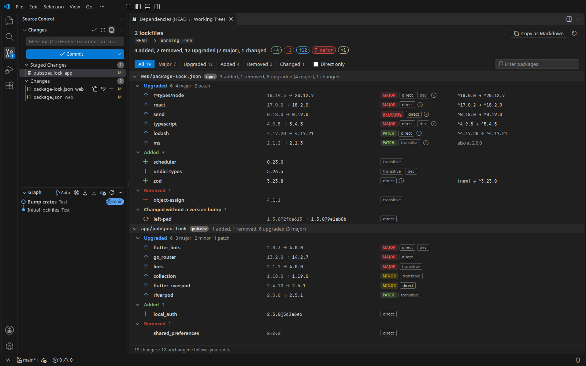
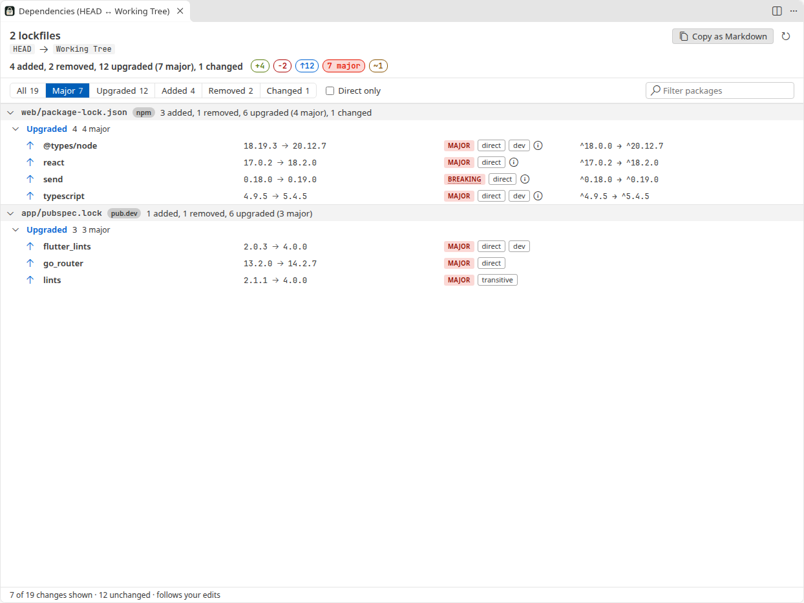
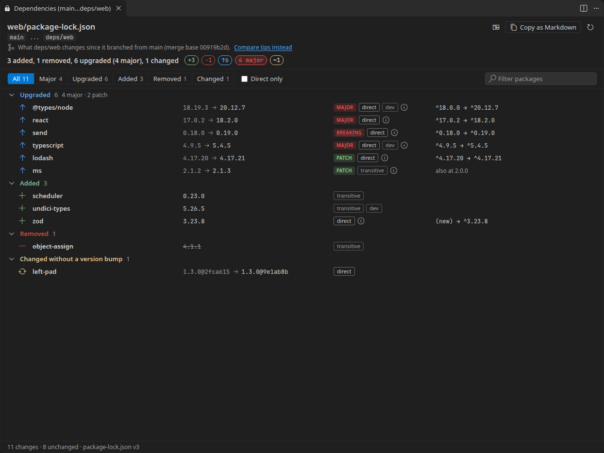
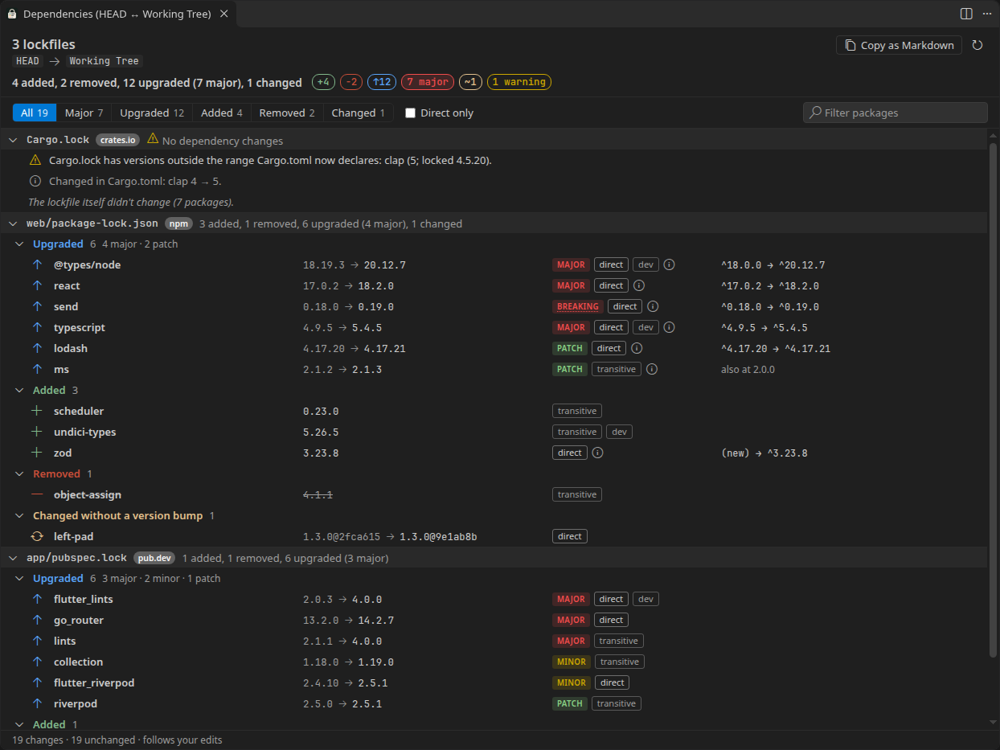
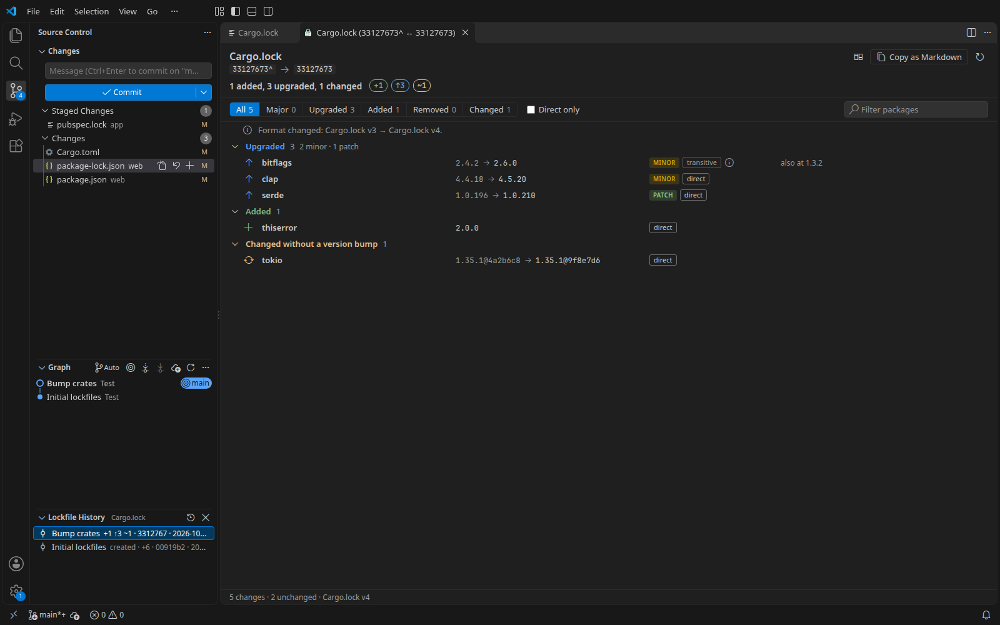

<h1 align="center">
  <br>
  Lockfile Diff
</h1>

<p align="center">
  See what a lockfile change does to your dependencies, not which lines moved.
</p>

<p align="center">
  <a href="https://github.com/heyliamme/lockfile-diff/blob/main/CHANGELOG.md">Changelog</a> ·
  <a href="https://github.com/heyliamme/lockfile-diff/blob/main/CONTRIBUTING.md">Contributing</a>
</p>



A dependency update touches one line of `package.json` and two thousand lines of
`package-lock.json`. The text diff of a lockfile is the part of a pull request nobody
reads, and it is where a surprise major version, a new transitive package or a
dependency that quietly moved to another registry hides. This extension reads both
versions of the lockfile and lists what changed in the dependencies:

- **Added, removed, upgraded, downgraded**, with each version change marked **major**,
  **minor**, **patch** or **prerelease**, and a one-line total such as
  *3 added, 1 removed, 6 upgraded (3 major)*. A `0.x` bump that the ecosystem's ranges
  treat as breaking (`^0.18` doesn't accept `0.19` in npm, Cargo and Composer) is marked
  **breaking** and counts as major.
- **Direct or transitive**, where the lockfile records it (or the manifest next to it
  does: `package.json`, `pyproject.toml`, `composer.json`, `go.mod`).
- **Declared ranges**: when the manifest next to the lockfile changed too, each direct
  dependency shows its range change (`^17.0.2 → ^18.2.0`) beside the resolved one, and
  the view warns when the lockfile wasn't updated or no longer fits the ranges.
- **What a branch changes**: comparisons with a branch start where your branch left it
  (the merge base, like `git diff main...feature`), so a pull request shows only its own
  changes. Tip to tip is one click away.
- **Lockfile History**: every commit that changed a lockfile, with what it did to the
  dependencies (*+3 −1 ↑12 (1 major)*); click one to see it in full.
- **Several versions of one package** are paired sensibly: `ms 2.1.2 → 2.1.3` while
  another copy stays at `2.0.0` is one upgrade, not a removal and an addition.
- **Changes without a version bump**: a git dependency on a new commit, a package that
  now comes from a different registry, or a checksum that changed for the same version.
- **Eleven lockfile formats** from seven ecosystems, including mixed repositories:
  every changed lockfile in one view.

## Install

From the [Visual Studio Marketplace](https://marketplace.visualstudio.com/items?itemName=heyliam.lockfile-diff),
from [Open VSX](https://open-vsx.org/extension/heyliam/lockfile-diff) (VSCodium, Cursor and
other editors), or from a terminal:

```bash
code --install-extension heyliam.lockfile-diff
```

## Getting started

Open a lockfile with uncommitted changes and click the **Show Dependency Changes**
button in the editor title bar. That compares HEAD with your working tree.



| To see | Do this |
| --- | --- |
| What your uncommitted changes do to a lockfile | Open the lockfile, then the title bar button (or **Show Dependency Changes** in the Command Palette) |
| The same for a diff you are already looking at (Source Control, Timeline, a pull request) | The title bar button in that diff editor: it compares exactly the two sides it shows |
| Every changed lockfile in the repository | The button in the **Source Control** title bar (**Show All Dependency Changes**) |
| One changed file from the Source Control list | Right-click it, **Show Dependency Changes**. Staged files compare HEAD with the index, the others the index with the working tree, as their diffs do. Select several to see them together |
| What your branch (and your uncommitted work) changes, as a pull request would show it | **Show Dependency Changes on This Branch** in the Source Control **…** menu: it compares with the default branch (`origin/HEAD`, else `main` or `master`) from the merge base |
| Your branch against `main`, a tag or any commit | **Compare with Branch, Tag or Commit…** in the editor title or Explorer context menu, or the Source Control **…** menu for every lockfile at once |
| Two branches, tags or commits (a Dependabot or Renovate branch against `main`) | **Compare Two Branches, Tags or Commits…** |
| Every commit that changed a lockfile | **Show Lockfile History** in the Explorer or editor title context menu, or the Source Control **…** menu |
| Two lockfiles on disk (another checkout, a migration from npm to pnpm) | Select both in the Explorer, right-click, **Compare Lockfiles** |

All commands are under **Lockfile Diff** in the Command Palette. Run with no lockfile
open, **Show Dependency Changes** and the compare commands cover every changed lockfile in
the repository.

## In the view



- **Filter** to major changes, upgrades, additions or removals, tick **Direct only** to
  hide transitive packages, or **search** by name or version (<kbd>/</kbd> or
  <kbd>Ctrl</kbd>+<kbd>F</kbd> jumps to the search box).
- **Copy as Markdown** puts the changes you are looking at on the clipboard as a table,
  with links to each package's registry page, ready for a pull request description:

  ```markdown
  ### Dependency changes

  4 upgraded (4 major) (HEAD → Working Tree).

  | Package | Change | From | To | Declared |
  | --- | --- | --- | --- | --- |
  | [react](https://www.npmjs.com/package/react/v/18.2.0) (direct) | major upgrade | `17.0.2` | `18.2.0` | `^17.0.2 → ^18.2.0` |
  | [send](https://www.npmjs.com/package/send/v/0.19.0) (direct) | breaking upgrade \(0.x\) | `0.18.0` | `0.19.0` | `^0.18.0 → ^0.19.0` |
  ```

- **Hover a row** for its buttons: open the package on its registry (npm, pub.dev,
  crates.io, PyPI, pkg.go.dev, Packagist, RubyGems), or go to its entry in the lockfile.
  Double-click does the latter too.
- **Several lockfiles** each get a header with their ecosystem and totals; click it to
  fold the file away. Its button opens the plain text diff.
- **Keyboard**: <kbd>↑</kbd> <kbd>↓</kbd> move, <kbd>←</kbd> <kbd>→</kbd> fold and unfold,
  <kbd>Enter</kbd> opens the registry page (or folds a header),
  <kbd>Shift</kbd>+<kbd>Enter</kbd> goes to the entry in the lockfile (on a file header, opens
  its text diff).

When one side is your working tree or the index, the view follows along: save the
lockfile, run an install or stage a file and it updates by itself.

### Branches: from the merge base



Comparing `main` with `deps/web` reads `deps/web`'s lockfiles against the commit where it
branched off `main`, the way a pull request diff does. Without that, everything `main`
did since (say, a crate bump) would show up reversed, as downgrades. The header names the
merge base and has a link to compare the two tips instead; the tab title uses Git's
`main...deps/web`. When one side already contains the other (your `main` behind
`origin/main` after a fetch, say), there is no branch point to start from: the two tips are
compared and the header says nothing about a merge base. Set `lockfileDiff.fromMergeBase` to `false` to start from
the tips.

### Manifests and declared ranges



The manifest next to each lockfile (`package.json`, `pubspec.yaml`, `Cargo.toml`,
`pyproject.toml`, `composer.json`, `Gemfile`) is read at the same revision. When its
declared dependencies changed:

- a direct dependency's row shows the range change next to the version change;
- a manifest that changed while its lockfile didn't brings that lockfile into the view
  with a warning: *package.json changes 2 dependencies, but package-lock.json didn't
  change: the lockfile wasn't updated*. `Cargo.lock` and `pubspec.lock` don't record
  declared ranges, so for them an unchanged lockfile is only flagged when it no longer
  fits the new range;
- a range the locked version no longer satisfies (`^18` with `17.0.2` locked), or a new
  dependency missing from the lockfile, is a warning too. Range syntax is read per
  ecosystem: npm, Cargo, Composer, pub, PEP 440 and Poetry, RubyGems; a range it can't
  read is never reported.

Warnings are counted in the summary and included in **Copy as Markdown**.

### Lockfile History



**Show Lockfile History** lists the commits on the current branch that changed a
lockfile, newest first, following the first parent so a merged pull request is one
entry. Each one says what it did (*+1 ↑3 ~1*, with majors marked); click it to see that
commit's changes in the view. The commits share one tab, so clicking through the list
doesn't pile up tabs. Commits load fifty at a time, and summaries fill in one by
one in the background, reading each version of the lockfile once. When HEAD moves (a
commit, a pull, a checkout), the list starts again from the new HEAD.

## Supported lockfiles

| File | Ecosystem | Formats | Direct dependencies from |
| --- | --- | --- | --- |
| `package-lock.json`, `npm-shrinkwrap.json` | npm | v1, v2, v3 | the lockfile (v2, v3); `package.json` (v1) |
| `yarn.lock` | npm | Yarn 1, Yarn 2 and later | the workspace entries (Yarn 2+); `package.json` (Yarn 1) |
| `pnpm-lock.yaml` | npm | 5.x, 6.0, 9.0 | the lockfile (importers) |
| `bun.lock` | npm | text lockfile (Bun 1.2+) | the lockfile (workspaces) |
| `pubspec.lock` | pub (Dart, Flutter) | all | the lockfile |
| `poetry.lock` | PyPI | 1.x, 2.x | `pyproject.toml` |
| `uv.lock` | PyPI | v1 | the lockfile (the project's own entry) |
| `Cargo.lock` | crates.io | v1 to v4 | the lockfile (the workspace's own crates) |
| `go.mod`, `go.sum` | Go modules | all | `go.mod` (`// indirect`) |
| `composer.lock` | Packagist | all | `composer.json` |
| `Gemfile.lock`, `gems.locked` | RubyGems | all | the lockfile (`DEPENDENCIES`) |

Manifests are read at the same revision as the lockfile, so a comparison with `main`
uses `main`'s `package.json` for that side. `bun.lockb`, Bun's older binary format, can't
be read; the view says how to switch to `bun.lock`.

## How it decides

- **Versions** are compared the way each ecosystem orders them: semver with
  pre-releases, PEP 440 (`1.0rc1`, `1.0.post2`, epochs), RubyGems (`1.2.0.pre1`), Go
  (`v2.0.0+incompatible`, pseudo-versions), Composer (`v1.2.3-RC1`).
- **Major, minor, patch** is the first of the three numbers that changed. A change only
  in the pre-release part (`2.0.0-rc.1 → 2.0.0`) is a *prerelease* change.
- **`0.x` versions** follow each ecosystem's rules. npm, Cargo and Composer apply semver's
  caret rule: `0.2 → 0.3` and `0.0.3 → 0.0.4` are **breaking** and count as major. pub
  does the same for `0.x` minor bumps (its `^0.0.3` accepts `0.0.4`). Go modules below v1
  promise nothing, so a `v0` minor upgrade is marked **v0 minor**, but not counted as
  major (`golang.org/x/…` bumps it every month). PEP 440 and RubyGems have no such rule:
  `0.2 → 0.3` is minor. Hover the badge for the reason.
- **Go pseudo-versions** (untagged commits, `v0.0.0-20240606120523-5a60cdf6a761`) show as
  the commit and its date, `5a60cdf (2024-06-06)`. Two commits after the same tag are a
  **commit** change, ordered by date; a commit after `v1.2.3` against `v1.2.3` is a patch.
- **npm aliases** (`"cjs": "npm:string-width@4"`) are listed under the real package, with
  the name they're installed as: `string-width as cjs`.
- **Several versions of one name**: versions on both sides are unchanged; the rest are
  paired by major version, then by nearness, so you see upgrades rather than
  add-and-remove pairs. What can't be paired is an added or removed copy, with a note
  naming the versions that remain.
- **Git and path dependencies** read as `version@commit`. A new commit at the same
  version is listed under *Changed without a version bump*.
- **Checksums** are compared only when both sides use the same kind, so npm moving from
  `sha1` to `sha512`, or a new Yarn cache key, is not reported as a change.
- **Go**: when `go.mod` is there, its `require` list is the source of truth for the
  selected versions. `go.sum` alone keeps every version that was ever consulted, so it is
  used only as a fallback.
- **Python** package names are normalized (`Django` and `django` are one package).

Large lockfiles are fine: two lockfiles of 50,000 packages each compare in about a third
of a second, and the list draws only the rows on screen.

## Settings

| Setting | Default | |
| --- | --- | --- |
| `lockfileDiff.defaultFilter` | `all` | What a new comparison shows first: `all`, `major`, `upgraded`, `added` or `removed`. |
| `lockfileDiff.directOnly` | `false` | Start with only direct dependencies shown. |
| `lockfileDiff.fromMergeBase` | `true` | Comparisons from a branch start at the merge base (`main...feature`). The view has a link to switch either way. |
| `lockfileDiff.exclude` | `[]` | Lockfiles to leave out of repository-wide comparisons, as globs relative to the repository root, such as `examples/**`. The view always says how many changed lockfiles it left out, and whether a workspace setting did it. In a multi-root workspace each repository folder can set its own. |
| `lockfileDiff.showTitleButton` | `true` | The button in the editor title bar of lockfiles and their diffs. |
| `lockfileDiff.showScmButton` | `true` | The button in the Source Control title bar. |

## Restricted Mode and privacy

In Restricted Mode, Git is not run (a repository's configuration can make Git run
programs), so comparisons with HEAD, branches or commits are unavailable and say so.
Comparing two lockfiles, or the two sides of a diff editor, still works.

Everything runs locally. The extension makes no network requests and collects no
telemetry; registry pages open in your browser only when you click a link.

## Known limitations

- It reads lockfiles, not your package manager's resolution logic.
- Declared ranges come from the manifest next to the lockfile. In a monorepo, the
  `package.json` (or `Cargo.toml`, `pyproject.toml`) of each workspace member is not
  read, and for Yarn 1 and npm v1 lockfiles that also means direct dependencies come only
  from the root `package.json`.
- `poetry.lock` and `composer.lock` know direct dependencies only when `pyproject.toml`
  or `composer.json` sits next to them.
- Yarn 2+ records `portal:` and `link:` packages as `0.0.0-use.local`, so a new version
  of one of those doesn't show.
- Lockfile History follows the file by its path: a lockfile that was moved or renamed
  starts its history there.

## Requirements

VS Code 1.90 or newer. Comparisons with Git revisions use the built-in Git extension,
or `git` on your `PATH` when that is disabled.

## License

[MIT](LICENSE). The extension includes [yaml](https://github.com/eemeli/yaml) (ISC),
[smol-toml](https://github.com/squirrelchat/smol-toml) (BSD-3-Clause) and the
[Codicons](https://github.com/microsoft/vscode-codicons) font (CC-BY-4.0, Microsoft); see
[ThirdPartyNotices.txt](ThirdPartyNotices.txt).
